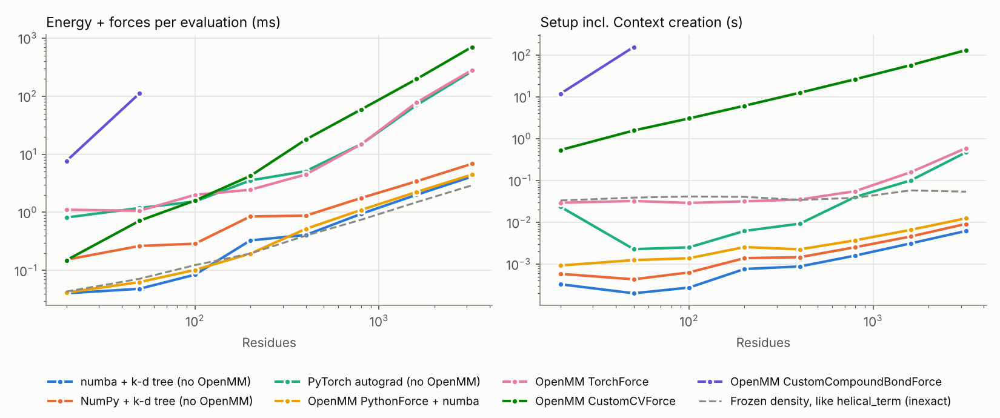

# Density-dependent helical terms: validation and benchmarks

`openawsem/functionTerms/helicalTerms.py` implements the AWSEM-MD `[Helix]` hydrogen-bond
term, including its dependence on the local density, in several interchangeable ways.
This folder holds the tooling that checks them against LAMMPS/AWSEM-MD (the gold
standard) and benchmarks them. The requirements, with Gherkin scenarios traced to the
tests by `rq-` IDs, are in [`rqm/helical_terms.md`](../../rqm/helical_terms.md).

## The term

For every residue pair `(i, j = i + 4)` in a chain, with `N_j` and `H_j` built from
`CA_{j-1}`, `CA_j` and `O_{j-1}`:

```
E = sum_ij  -k_helix * (h4prob(a_i) + h4prob(a_j))
            * exp(-(R_NO - r0_NO)^2 / (2 s_NO^2) - (R_HO - r0_HO)^2 / (2 s_HO^2))
            * (gamma_p + (gamma_w - gamma_p) * H(rho_i) * H(rho_j))

H(rho)  = (1 - tanh(kappa_sigma * (rho - rho_0))) / 2          # 1 exposed, 0 buried
rho_r   = sum_s theta(|CB_r - CB_s|)   over beads with |r - s| > 1 or another chain
```

`H(rho_i) * H(rho_j)` is what makes the term hard to write in OpenMM: each pair energy
depends on the positions of every density bead near residues `i` and `j`, not only on
the four backbone beads of the hydrogen bond. `hydrogenBondTerms.helical_term` drops it
(every pair is treated as buried).

## Why OpenMM's custom forces are not enough on their own

| OpenMM class | Limitation |
|---|---|
| `CustomHbondForce` | At most 3 particles per donor/acceptor; the density needs all beads. |
| `CustomGBForce` | Only one `ParticlePair` computed value per force (a second raises on the Reference and CPU platforms) and energy terms are at most two-body. The term needs rho_i, rho_j and two O-N/O-H distances in one product. |
| `CustomCompoundBondForce` | Exact if each bond carries every density bead, but OpenMM differentiates the expression with respect to each of the 2N+6 particles of a bond, so Context creation grows faster than N^2 (11 s at 20 residues, 154 s at 50). |
| `CustomCVForce` | At most 32 collective variables per force (the 33rd raises). Blocks of 14 pairs fit, and the blocks nest into one Force at no measurable cost. |

## Implementations

| Term / backend | Where it runs | Exact | How |
|---|---|---|---|
| `helical_term_cvforce` (default of `density_dependent_helical_term`) | OpenMM | yes | gamma_p part as CustomCompoundBondForce + blocks of <= 14 pairs as CustomCVForce (densities as CustomBondForce CVs, hydrogen-bond factors as one-bond CustomCompoundBondForce CVs), nested into one Force. Serializable. |
| `helical_term_pythonforce` | OpenMM >= 8.3 | yes | `openmm.PythonForce` over `NumbaHelix` (default), `NumpyHelix` or the torch module. Serializable. |
| `helical_term_torchforce` | OpenMM + openmm-torch | yes | `openmmtorch.TorchForce` over the TorchScript module (GPU capable). |
| `helical_term_compound` | OpenMM | yes | One CustomCompoundBondForce carrying every density bead; up to `max_residues=30`. |
| `helical_term_frozen_density` | OpenMM | no | Weights frozen at a structure (exact energy there, no density forces) or at gamma_p like `helical_term`. |
| `reference_energy_forces` | NumPy loops | yes, incl. AWSEM-MD's force truncation | Line-by-line port of `FixBackbone::compute_pair`; the executable spec. |
| `NumpyHelix`, `NumbaHelix` | NumPy / numba | yes | Vectorized / compiled, with a k-d tree neighbour list above 100 / 300 residues. |
| `make_helix_module` | PyTorch | yes | Autograd forces; `learnable=True` makes `k_helix`, `gamma_p`, `gamma_w` and the propensities trainable. |

```python
from openawsem.functionTerms import helicalTerms

forces = [
    ...,
    helicalTerms.density_dependent_helical_term(oa),                     # cvforce, k = 0.5 kcal/mol
    # helicalTerms.helical_term_pythonforce(oa, backend='numba'),       # fastest on CPU
    # helicalTerms.helical_term_torchforce(oa),                         # GPU candidate
]
```

`k_helical` (kJ/mol, default 0.5 kcal/mol = 2.092 kJ/mol, as in AWSEM-MD's 1R69 example
and the buried limit of `helical_term`) replaces `HelixParameters.k_helix`; pass
`k_helical=None` to keep the value of `parameters`, e.g.
`HelixParameters.from_fix_backbone_coeff('fix_backbone_coeff.data')`.

### AWSEM-MD behaviours reproduced

* AWSEM-MD compiles `pair_flag` to 1, so the active code is `compute_pair` +
  `compute_helix_dtheta_pair`, not `compute_helix_potential`. In that path the last
  residue of a chain can be a donor.
* `R_NO >= cutoff` switches a pair off (hard cutoff; 6 A in the default parameter file).
* The density well is zero outside `r_min - 8 ln10/kappa < d < r_max + 8 ln10/kappa`.
* Density forces with `|dE/drho_r + dE/drho_s| <= 1e-6` are dropped (`delta_helix_xi`),
  so LAMMPS forces differ from the exact gradient by up to 3e-6 kcal/mol/A;
  `reference_energy_forces` and `NumpyHelix(delta_helix_xi=1e-6)` reproduce it, the
  other backends compute the exact gradient.
* The `[ABC]` coefficients sum to 1.0000364 (N) and 1.00007 (H), so the energy is not
  exactly translation invariant and the net force is not zero.
* Proline donors are included with `h4prob[P] = -3.0` (`helical_term` skips them and uses
  0.4 for proline); `pro_acceptor_flag` swaps the propensity of a proline acceptor.

## Validation

`tests/data/helical_reference/` holds energies and forces from LAMMPS (22 Jul 2025
update 6) built with AWSEM-MD (commit in `MANIFEST.json`): 1R69, the 1CTA and FIS
homodimers, myoglobin and the 2XOV helical bundle (six frames each: native, noise of
0.25/0.5/1.0 A, expanded, compressed), non-helical controls, five parameter sets, edge
cases (Gly/Pro at every position, chains of 1 to 6 residues, O-N distances at the
cutoff, compression below the well range, an extended chain), and the 12 frames of
OpenAWSEM's 1MBN test trajectory. The reference port reproduces them to ~1e-13; every
exact implementation to 1e-6 kcal/mol in energy and 1e-5 kcal/mol/A in force on the
Reference and CPU platforms, including inside a real `OpenMMAWSEMSystem`. Along the
1MBN trajectory, `helical_term` and `helical_term_frozen_density` differ from AWSEM-MD
by up to 20 kcal/mol (AWSEM-MD: -52.8 to -13.4 kcal/mol).

To regenerate the data, build LAMMPS with AWSEM-MD and run the generator:

```bash
git clone --depth 1 -b stable_22Jul2025_update6 https://github.com/lammps/lammps.git
git clone https://github.com/adavtyan/awsemmd.git
cp awsemmd/src/*.cpp awsemmd/src/*.h lammps/src/
(cd lammps/src && make yes-molecule && make serial -j4)
AWSEMMD_LMP=$PWD/lammps/src/lmp_serial python devtools/helical_reference/make_reference.py --awsemmd awsemmd
```

With `AWSEMMD_LMP` set, `tests/test_helical_reference_tools.py` also runs LAMMPS live.

## Benchmarks

One energy + force evaluation, median of 5, on a 4-core x86_64 cloud container
(no GPU), OpenMM 8.5.2, PyTorch 2.12.1. Systems are tiled myoglobin copies
(`benchmark.py`); full tables, including the CPU platform and setup times, are in
[`results/helical_benchmark.md`](results/helical_benchmark.md).



| ms per evaluation (OpenMM Reference platform) | N=50 | N=200 | N=800 | N=3200 |
|---|---:|---:|---:|---:|
| `helical_term_pythonforce`, numba (exact) | 0.063 | 0.20 | 1.1 | 4.5 |
| `helical_term_pythonforce`, numpy (exact) | 0.29 | 0.59 | 2.0 | 7.4 |
| `helical_term_torchforce` (exact, CPU torch, dense pairs) | 0.78 | 2.2 | 21 | 276 |
| `helical_term_cvforce` (exact) | 0.72 | 4.2 | 59 | 701 |
| `helical_term_compound` (exact) | 112 | - | - | - |
| `helical_term_frozen_density` (inexact) | 0.072 | 0.20 | 0.75 | 2.9 |

| Setup, s | N=50 | N=200 | N=800 | N=3200 |
|---|---:|---:|---:|---:|
| `helical_term_pythonforce`, numba | 0.001 | 0.003 | 0.004 | 0.013 |
| `helical_term_torchforce` | 0.02 | 0.02 | 0.05 | 0.72 |
| `helical_term_cvforce` | 1.6 | 6.1 | 27 | 132 |
| `helical_term_compound` | 156 | - | - | - |

### Which one to use

* **`helical_term_cvforce` is the default for now.** It is exact and made of plain,
  serializable OpenMM forces, but every block is its own inner Context, so setup takes
  seconds to minutes and evaluation grows as N^2. It is 4-47x slower on the CPU
  platform than on the Reference platform at these sizes; `properties={'Threads': '1'}`
  on the CPU platform recovered about 2.7x (105 -> 39 ms at 200 residues).
* **On CPU, `helical_term_pythonforce` (numba) is the fastest exact option**: about as
  fast as the inexact frozen-density force (within 1.6x at every size) with negligible
  setup. It needs OpenMM >= 8.3 and runs in Python on the host each step.
* **GPU: not benchmarked yet.** `helical_term_torchforce` runs inside OpenMM on the GPU
  with openmm-torch, and its dense O(N^2) density, the slow part on CPU, should map well
  to a GPU for a few thousand residues; `helical_term_cvforce` on CUDA/OpenCL pays a
  launch overhead per block; `helical_term_pythonforce` copies positions and forces
  between device and host every step. To measure, run
  `python devtools/helical_reference/benchmark.py --platforms CUDA --properties Precision=mixed`.
* `helical_term_compound` is exact but only usable up to about 20 residues;
  `helical_term_frozen_density` is not exact (no density forces).
